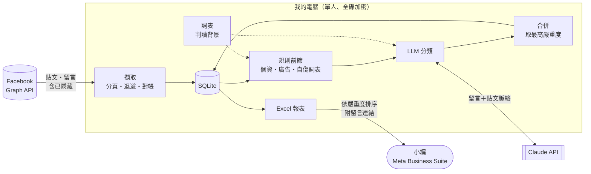
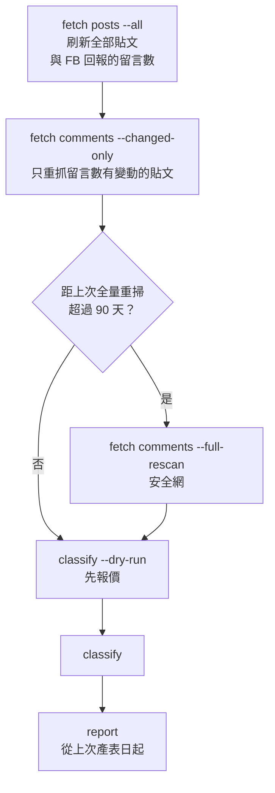
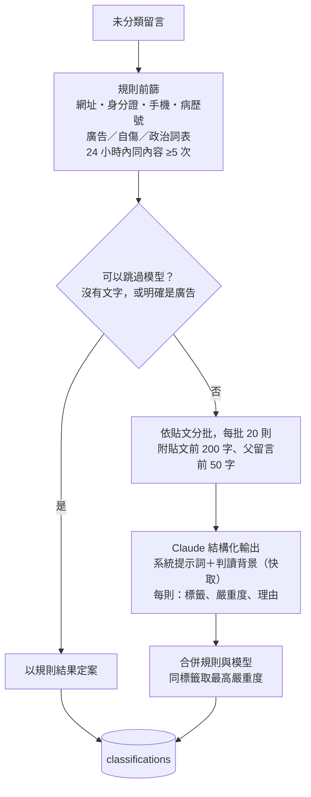
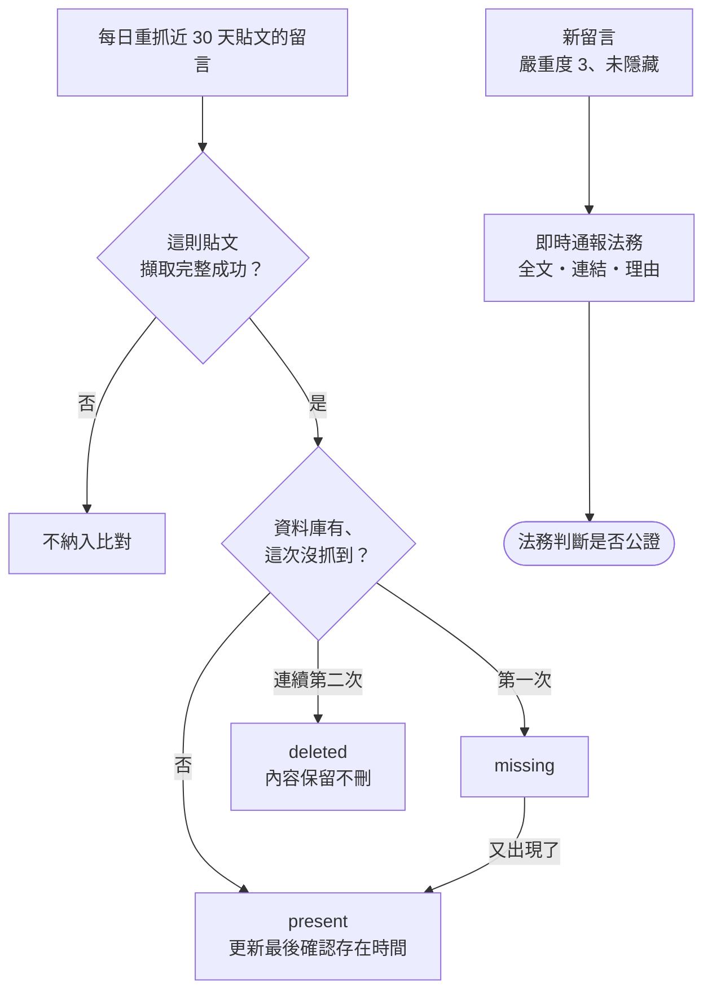

## 十一年，沒人翻得完

花蓮慈濟醫院的粉專是 2015 年 8 月開的，到現在十一年，4,199 則貼文，14,664 則留言。

公傳小編的日常是這樣：發完文，回頭看一下留言區，太過分的就隱藏。下一篇貼文出來，再來一次。

這種做法有兩個看不到的地方。一是注意力只在最新的幾篇貼文，舊貼文底下過了幾天、幾個月才冒出來的留言，不會有人回去看。二是畫面一次只看得到一則貼文的留言，同一段文字分散貼在十幾篇貼文底下，小編看到的是十幾件零星的事，不會知道那是同一件。

後來把資料攤開才知道漏了什麼。同一段指控文字貼了 41 次，小編隱藏了 25 則，另外 16 則一直掛著。有 83 則是民眾自己在留言裡打出身分證字號或電話，到現在還公開著。還有 16 則是民眾來通報有人冒用醫院名義詐騙，其中幾則提到已經有病友被騙。

我想做的事很單純，把翻不完的東西，變成看得完的清單。

## 整套長這樣

整套有三條規矩：

- 只有分類那一步叫語言模型。抓資料、前篩、找重複、產報表、算準確率，全部是一般程式，跑兩次結果一樣。
- 系統不回寫 Facebook。不隱藏、不刪除、不封鎖、不回覆，所有處置都是人在 Meta Business Suite 裡按的。
- 單人本機工具。Python 3.12 加 uv，一個叫 `smc` 的命令列程式，資料庫是一個 SQLite 檔，放在全碟加密、不在雲端同步資料夾裡的電腦上。

動手前一樣先寫規格書，其中第五節是法遵、隱私與倫理，寫明是硬性約束，不能用「比較方便」當理由跳過。下面照流程一段一段講。

## 先把十一年的留言抓下來

### 為什麼要做

要判讀，先得有資料。Facebook 後台可以一則一則看，但沒有辦法把十一年的留言一次匯出成可以分析的格式。

### 怎麼做

- 走 Facebook 官方的 Graph API，用粉專管理者授權的 Page Token。抓的時候帶 `filter=stream`，被小編隱藏的留言也拿得到，十一年累積了 805 則。被隱藏本身就是一種標註，這批資料後面很有用。
- 每則貼文抓完記一個 checkpoint，中斷了可以接著跑。遇到速率限制就退避，錯誤會分類，權杖過期跟網路斷線是不同的處理。
- 每次擷取的範圍都寫進 `sync_runs` 表。報表產生時會檢查涵蓋率，有缺口就警告。這是整個專案最怕的失敗：某段期間根本沒抓，報表回傳空的，看起來跟「那段期間沒有問題留言」一模一樣。
- 例行更新用一支腳本跑。先刷新全部貼文的留言數，跟資料庫比對，只重抓數字對不上的貼文。全量重掃要跑 2,211 則貼文，差異重掃只要 176 則，省掉九成。新增一則又刪掉一則時總數不變會漏掉，所以每季還是強制全量重掃一次。
- 資料庫裡沒有一般民眾的姓名或帳號。標準權限下 Graph API 本來就不給，我也決定不去申請進階權限。核心目的是偵測加人工複核，用不到身分；小編要知道是誰講的，從留言連結點過去看。

### 做完之後

十一年的留言第一次全部在同一個地方，連小編隱藏過的、後來被刪掉而 Facebook 已經不再回傳的都在。往後每月更新一次，一個指令，大約一分鐘。

## 規則先篩，模型再判

### 為什麼要做

一萬多則留言全部丟給模型，貴，而且有些根本不用判斷，空白的、純貼圖的。反過來，只靠關鍵字也不行，「醫術真好呢」是稱讚還是嘲諷，要看那篇貼文在講什麼。

所以拆成兩段：規則處理確定的事，模型處理要看語境的事。

### 怎麼做

- 標籤有十一種：人身攻擊、機構謾罵、嘲諷、醫療申訴、疑似不實資訊、廣告、個資揭露、自傷風險、威脅恐嚇、政治相關、正面與中性。嚴重度分 0 到 3，3 是需要主管即刻處理。
- 規則只負責確定的事。身分證字號用檢查碼驗、手機跟病歷號用樣式比對。自傷關鍵詞命中時不會自己下結論，而是強制送模型複核並提高優先序。
- 重複內容不直接當洗版。一開始的規則是 24 小時內重複 5 次就標廣告，結果在佛教醫院的粉專上，重複最多的是兩到六個字的日常祈福和感謝用語，是不同的民眾各自留的，兩千則樣本裡誤標了 250 則。沒有留言者身分，分不出是一個人貼二十次還是二十個人各貼一次，所以改成只提高優先序、把線索交給模型，另外加上至少 8 個字的門檻。
- 送模型時同一篇貼文的留言排在一起，附上貼文前 200 字；如果是回覆，附上父留言。用結構化輸出強制 JSON 格式，每則回標籤、嚴重度、50 字內的理由，理由裡不准複述罵人的內容。
- 系統提示詞固定不變，開 prompt caching，提示詞裡不放時間戳，前綴才不會失效。
- 政治只是中性標記，代表內容涉及政治議題，不代表要處理，嚴重度也不計入整體排序。報表上會寫明這一點。
- 跑之前先 `--dry-run`，用 `count_tokens` 精算費用，不花錢。

短句反諷是最難的。「哇真棒呢」要有時事背景才看得懂，貼文前 200 字裡通常沒有。所以另外做了一份判讀背景設定檔 `context.md`，寫近期的爭議事件，純文字，不會寫程式也能改，跟系統提示詞一起送進去。

### 做完之後

全量判讀一次 US$6.46，大約新台幣兩百出頭。往後每月只判新增的，實測兩個月份合計 US$0.29。

## 準不準，要有東西比

### 為什麼要做

這種系統最容易講幹話的地方就是準確率。要說它準，得有一份人判過的答案來對。

### 怎麼做

公傳室手上有 877 則先前標註過的留言（其實是我用另一個 agent 協助標的），用 `smc eval import` 匯入，`smc eval run` 算每一類的準確率跟涵蓋率。規格規定提示詞每改一次都要重跑評估、記進 `eval-log.md`，免得憑幾個例子調參，修好一類、弄壞另一類。

| 人工類別 | 準確率 | 涵蓋率 |
| --- | ---: | ---: |
| 謾罵／人身攻擊 | 0.85 | 0.76 |
| 嘲諷／陰陽怪氣 | 0.71 | 0.63 |
| 負面質疑 | 0.44 | 0.62 |

嘲諷的涵蓋率原本只有 0.27，準確率卻是 1.00。意思是系統認定是嘲諷的時候都對，只是看不懂那些指涉外部事件的短句。加上判讀背景之後拉到 0.63，這是單一改動裡效益最大的。

負面質疑的 0.44 是過度標記，一般抱怨被升級成質疑，還在調。

另外加了一個指標叫偵測率：人工認定有問題的留言裡，有多少被送進報表。標錯類別跟完全漏抓，在 F1 上扣一樣的分，對小編來說卻差很多，標成嘲諷但其實是謾罵，打開報表照樣看得到。用這個指標回頭看，發現報表門檻設在嚴重度 2 的時候偵測率只有 58%，漏掉的有一大半是嚴重度 1 的嘲諷。公傳室的人工標註把嘲諷全部列為負面留言，所以預設門檻改成 1，偵測率變成 87%。

### 做完之後

判讀品質有數字可以講，弱點在哪裡也清楚。

## 小編看得完的報表

### 為什麼要做

前面做再多，最後要變成小編每天打開就能處理的東西。小編要的不是統計圖，是一張「哪幾則要看、點下去就到」的清單。

### 怎麼做

- `smc report` 產生一份 Excel，第一張工作表就是需關注留言，依嚴重度排序，紅橘黃三色標示，每一列附一個直達那則留言的連結。點下去就到 Facebook，該隱藏就隱藏。
- 自傷風險的留言置頂，並提示關懷轉介流程。這是病人安全，不是負面輿情。
- 摘要頁寫明系統看不到什麼。987 則純圖片留言完全沒有判讀，而且已經知道有人把攻擊文字做成圖片來閃過文字偵測。與其讓人以為報表就是全部，不如讓他知道盲區在哪。
- `--since`、`--until` 在擷取時指貼文時間，在報表時指留言時間，兩個意思不一樣，規格裡特別標出來。

### 做完之後

先講好消息，多數留言是好的。

| 分類 | 則數 |
| --- | ---: |
| 正面回饋，感謝、祝福、鼓勵 | 8,533 |
| 只有圖片或貼圖，沒有文字 | 2,805 |
| 一般中性，詢問、閒聊 | 2,157 |
| 合計，不需要處理 | 13,495（92%） |

光是正面回饋就佔了 58%。剩下的收斂成 776 則需關注，再從裡面挑出最嚴重、而且還沒被隱藏的，只有 38 則。存量一次清完估計四個小時，之後每月複核大約十分鐘。

需要留意的類別，依標籤次數算（一則留言可以同時有好幾個標籤）：

| 類別 | 總共 | 仍顯示中 |
| --- | ---: | ---: |
| 醫療處置的抱怨 | 401 | 282 |
| 不實訊息 | 223 | 101 |
| 罵醫院 | 211 | 76 |
| 廣告、洗版 | 169 | 124 |
| 罵特定人員 | 169 | 63 |
| 嘲諷、陰陽怪氣 | 140 | 116 |
| 民眾自己貼了個資 | 102 | 83 |
| 政治話題 | 74 | 52 |
| 激烈辱罵字眼 | 14 | 9 |
| 提到自傷或輕生 | 4 | 3 |

個資那一類，是民眾自己在公開留言裡打出身分證字號或電話，還有 83 則掛在上面。隱藏這種留言是在保護他們，不是在管制言論。

系統標為自傷、還顯示中的 3 則，我一則一則看過，全部是誤判，一則在抱怨探訪方式，兩則在討論安樂死新聞。目前沒有人在求救，但這一類每次都要人看過，不能直接相信系統。

嚴重度也是一樣。類別跟每一類的嚴重度上下限是我定的，但嚴重度 2 跟 3 之間的界線沒有精確定義，同樣是罵醫院，為什麼這則算最嚴重、那則不算，沒有可以驗證的準則。這也是系統只整理、不自動處置的原因。

報表也看到了逐則處理時看不到的東西。同一段指控文字貼了 41 次，散在 13 則貼文，集中在兩天之內，小編隱藏了其中 25 則，另外 16 則還在。另一段文字貼了 55 次，散在 55 則貼文，全部都被隱藏了，等於有人手動按了 55 次。這不是誰不夠認真，逐則審核的介面本來就會把一件事拆成五十五個雜訊。

還有一個意外。民眾主動留言通報有人冒用醫院名義詐騙，一共 16 則，其中幾則提到已經有病友被騙，但有 11 則被系統評為嚴重度 0。系統是為了抓攻擊設計的，這類留言性質剛好相反，是善意的提醒，卻同樣需要有人回應。

## 爭議留言在被刪之前送到人手上

### 為什麼要做

我擔心的是，當事人自己把留言刪掉，就沒有東西可以追究了。原本規劃的是自動截圖存證：程式打開每一則風險留言、把畫面存下來。

這是我自己提的，後來自己否決了。

先講清楚，管理員自己打開頁面截圖完全沒問題，那是正常使用。有問題的是用程式自動打開幾百個頁面逐一擷取：

- Facebook 服務條款禁止以自動化方式存取或蒐集資料。違反的後果是帳號或粉專被限制，而現行系統的權杖綁在同一個帳號上，被限制的話連留言擷取都會一起停擺。
- 實際測過，每張截圖都會拍進好幾位其他民眾的姓名跟大頭照，這些人什麼都沒做。
- 自己截的圖證明力薄弱，對方可以爭執真偽，實務上採認度比較高的是網頁公證。
- 留言一旦被刪，任何形式的存證都來不及，包括截圖。

而且留言內容其實早就存在資料庫裡了，全文、時間、留言編號、連結都在，留言被刪掉之後紀錄也不會消失。截圖能多給的，只有留言者的姓名跟長相。

所以問題從「事後保存」改成「縮短反應時間」：在留言還在的時候讓法務知道，由法務決定要不要辦公證。

### 怎麼做

- 擷取時本來就包含被隱藏的留言，所以重抓後消失的，代表是真的不見了，不是被藏起來。
- 「這則留言在某天被刪除」是會被拿去做決策的陳述，誤判代價很高。所以只有那則貼文擷取完整成功時才比對，連續兩次沒出現才認定刪除，刪除時點只寫成一個區間。
- 嚴重度 3 且未隱藏的新留言即時通報，嚴重度 2 併入每日彙整。通報內容要讓法務不用登入任何系統就能判斷值不值得處理。以現有資料估算，平均每天 0 到 2 則。

### 做完之後

這一段目前只有規格，還沒實作，老實說也不一定會實作。

整個專案是我自己覺得該做就做了，單位裡沒有人提過這個需求，大部分的人也不知道有這套東西。通報要寄給誰、公證誰來辦、刪掉的留言要留多久，現在都沒有人可以問。

規格先放著。哪天真的有一則留言需要追究，法務至少有一套現成的做法可以用，不用從頭想。

## 程式碼與那幾份不公開的清單

程式放在 GitHub：[Facebook-fan-page-comment-output-and-risk-content-detection](https://github.com/petertsengtw/Facebook-fan-page-comment-output-and-risk-content-detection)，130 個測試，測試跟正式資料庫、`.env`、API 完全隔離。

版控裡的關鍵詞表跟判讀背景設定檔都只是範本，實際使用的是同名的 `.local` 版本，不進版控。一份「監測中的政治關鍵詞」清單如果被單獨截圖轉發，讀者不會看到規格裡「政治為中性標記、不得作為處置依據」那一段，脈絡會在轉發的過程中掉光。公開完整的偵測準則，也等於教人怎麼規避，而我們已經知道有人在規避了。

## 誰用得到

| 做了什麼 | 誰用得到 |
| --- | --- |
| 十一年留言全部入庫，每月一分鐘更新 | 公傳室，第一次有完整的留言紀錄 |
| 規則加模型分類，每月不到一美金 | 小編，不用再逐則翻 |
| 對照人工標註的品質評估 | 公傳室，知道這份報表能信到什麼程度 |
| 依嚴重度排序、附連結的 Excel | 小編，每月複核大約十分鐘 |
| 跨貼文重複內容與民眾詐騙通報 | 公傳室，看見逐則處理時看不到的事 |
| 刪除偵測與即時通報（只有規格） | 法務，如果有一天用得上 |

系統目前的狀態是可用，維運功能待開發。複核結果還不能回寫，所以同一批留言每次都會重新列出來，清單不會變短，這是下一步要補的。
