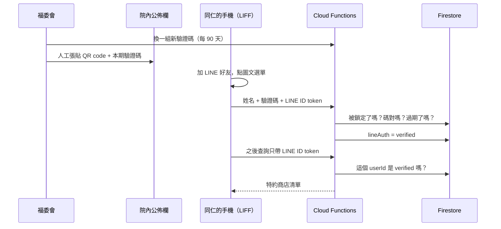
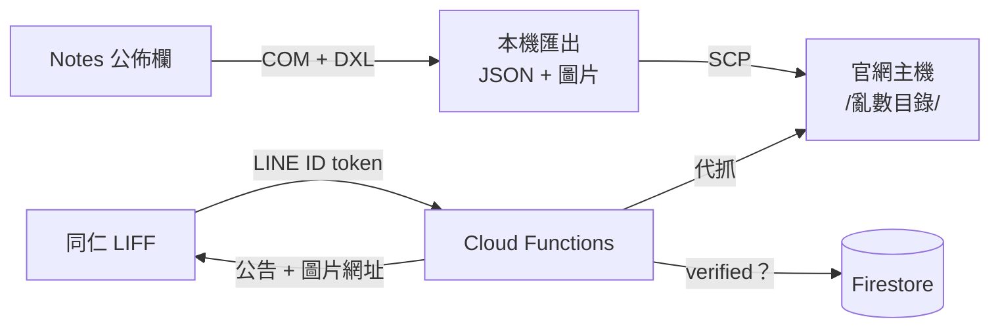
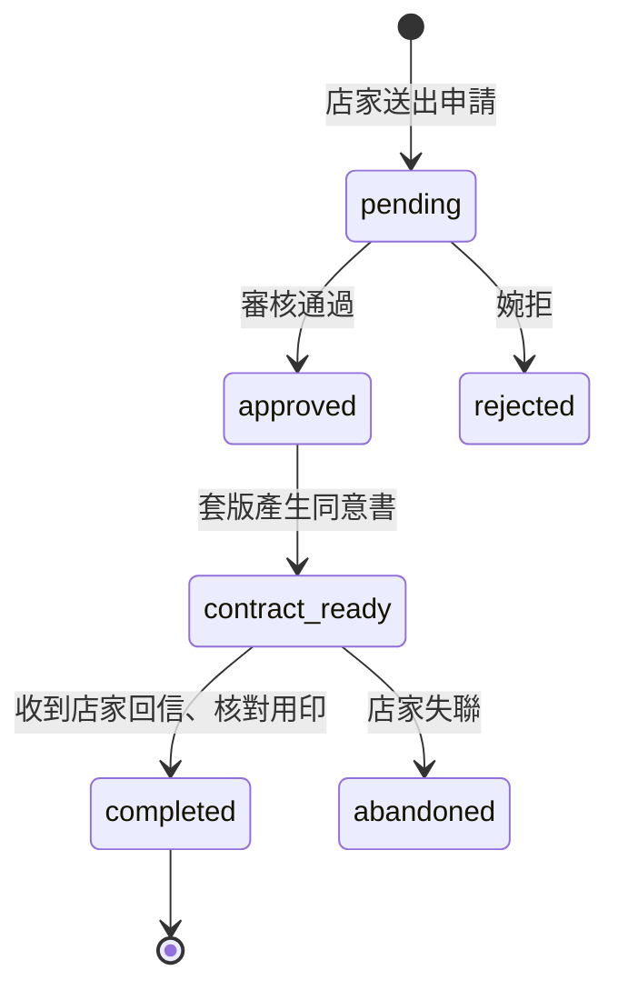
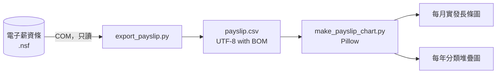

## 遺跡現場


醫院裡有一套 Lotus Notes。

Lotus 在 1989 年做出來，六年後被 IBM 買走，再後來又被轉手給 HCL。它比我們院裡很多同事都資深，我們用了十幾年，大概還會再用十幾年。

新聞稿、公佈欄、特約商店、薪資條，全部住在裡面，一個功能一個資料庫，副檔名叫 `.nsf`。


資料都在，就是出不來。想把東西搬到別的地方，標準作業程序是：打開用戶端、點開文件、全選、複製、貼上。重複到退休。

好消息是 Notes 留了一個後門給程式用，叫 COM。Windows 上的 Python 用 `win32com` 叫起 `Lotus.NotesSession`，拿自己的 Notes ID 登入，就能像用戶端一樣開資料庫、讀 View、讀欄位。不用碰伺服器，也不用寫公文去跟誰要 API。

```python
import win32com.client

session = win32com.client.Dispatch("Lotus.NotesSession")
session.Initialize(password)
db = session.GetDatabase(server, "OAuse\\ContributingStore.nsf")
view = db.GetView("依商店")
doc = view.GetFirstDocument()
while doc:
    name = doc.GetItemValue("fd_ObjectName")[0]
    doc = view.GetNextDocument(doc)
```

壞消息是那個 COM 元件是 32 位元的。

呼叫它的行程也必須是 32 位元，所以整個專案跑在一個 32 位元的 Python 3.14 上。2026 年，32 位元。這件事在後面每一段都會回來找我，像一個甩不掉的前同事。

## 整座遺跡長這樣

從六月挖到現在，大概長成這個樣子：


分工有一條規矩，每個功能都照著走：重活在本機做，雲端只管狀態跟權限。

本機那台電腦手上沒有任何 Firebase 憑證，要寫資料就拿一組共用密鑰去敲 Cloud Functions 的管理端點，敲完就走。它是整條路上權限最小的一環，這是刻意的。那台機器在院內網路、沒有公開 IP，也不一定開著，讓它當最弱的一環剛剛好。

每個功能動手前，我都先寫一份規格書，寫要做什麼、不做什麼、驗收怎麼算。寫完再丟給 AI 一起做。下面一個一個講。

## 新聞稿自己走上官網

以前刊一篇新聞稿，得有人從 Notes 把文字複製出來、圖片一張一張另存、再到 Joomla 後台貼上、上傳、排版。圖片常常漏帶，排版常常跑掉。

現在是這樣：


Notes 的 RichText 用 `.Text` 讀出來會在句子中間硬斷行，圖片也不知道原本在哪。所以改用 DXL，把整份文件匯出成 XML，照順序走一遍，文字段落跟圖片的相對位置記在 `layout.json`。上傳時照著這份排回去，圖說接在圖片下面，第一張圖設成摘要圖片，比照同事手工上稿的樣子。

文章一律建成草稿，`state=0` 寫死在程式裡。按發佈這件事永遠留給人。程式寫錯頂多多一篇草稿，不會半夜在官網首頁出現一篇亂碼。

中間有想過要不要上 agent 框架，讓 AI 自己判斷。後來仔細看，整條流程裡需要判斷的只有「這兩個長得很像的標題是不是同一篇」，而且最後本來就有人審稿。排程加上一則 LINE 通知就夠了。

## 特約商店只給同仁看


職工福利小組幫同仁談了一百多家特約商店，資料在 Notes 的特約商店資料庫。


第一版很陽春：資料倒成 JSON，跟一個查詢頁一起 SCP 到官網主機上，前端 `fetch("./stores.json")`，誰都看得到。

上線一陣子，重新盤點合約，看到一句「本優惠僅提供予甲方所屬員工，不得轉借他人使用」。網頁完全公開，這句話就只剩裝飾作用。

要限制只有同仁能看，第一個方案是寄信：同仁輸入 Notes ID，系統查通訊錄拿到信箱，寄一封驗證連結。規格寫好了才實際去測，福委會那個共用帳號只能寄信，查不了通訊錄。整個方案原地解散。

其他選項也一一陣亡。身分證字號牽涉個資的目的外利用，光是要跑的程序就夠我寫三份規格書。員工編號，大部分人記不住自己的。院內的上網認證頁，人一走出醫院就連不到，而同仁最需要查優惠的時刻，剛好是站在店家櫃檯前面。

最後是 LINE 官方帳號加一組驗證碼：




驗證只做一次。之後同仁在 LINE 裡點一下就能查，不用記任何帳號密碼。

幾條規格書裡寫得很硬的規矩：

- 權限判斷只在後端做。「這個頁面只能在 LINE 裡打開」是前端的事，不算數。
- Firestore 的安全規則是全部拒絕，只有後端用 Admin SDK 寫得進去。
- 能把一個人標成 verified 的路徑只有一條，就是輸入正確的驗證碼。不留測試後門，不留管理員快速通關。
- 連續打錯幾次就鎖一段時間。

刻意不做的也寫在裡面。不查證你是不是真的叫這個名字。驗證碼外流，接受。真正兌換優惠要在店家櫃檯出示識別證，網頁只要擋住「路人用 Google 搜到網址」就功德圓滿。

離職的人怎麼移除，是做完才想到的。每季拿一份在職名單比對，不在名單上的撤銷。這段寫得很膽小：預設只產生報告，確認沒問題再加 `--commit` 才真的撤銷；新名單人數如果少於目前已驗證人數的一半，直接擋下來。我怕的是哪天有人傳了一個只存了一半的 Excel，系統一口氣把半個醫院踢出去。

驗證碼 90 天換一次。十月補了一個提醒，到期前 14 天 LINE 我。不然按照我的記性，大概會等到新同仁跑來問「為什麼碼不能用」才想起來。

## 福利公告搭便車

身分驗證做好之後，第二個功能幾乎是順手的。

福利小組平常在院內公佈欄發公告，中秋禮盒預購、好康轉知那些。公佈欄是另一個 Notes 資料庫，全院各單位的公告擠在一起，同仁要自己翻。

程式只挑福利小組發的、還沒過期的公告，用跟新聞稿一樣的 DXL 手法把圖片挖出來。

這次資料沒放 Firebase。JSON 跟圖片直接放在官網主機上一個用 24 bytes 亂數命名的目錄，沒有任何頁面連過去，目錄列表回 403，猜錯路徑回 404。同仁查詢時，Cloud Functions 先確認身分，再由它代替使用者去那個目錄抓資料，瀏覽器從頭到尾不知道真正的網址。



這比特約商店那套鬆很多，也是刻意的。公告本來就是貼給全院看的轉知訊息，用不著跟有合約限制的資料穿同一件防彈衣。

上線時抓到 18 則公告、30 張圖。

實際踩到的坑是 LINE。一個 LIFF app 只綁一個網址，兩個頁面共用同一個 LIFF app 的時候，從圖文選單點進公告頁會一直拿不到登入狀態，同仁會被要求重新輸入驗證碼。最後替公告頁另外開一個 LIFF app 就好了。官方文件沒騙人，只是我沒看清楚。

## 店家線上申請，改了三次

這份規格書最長，將近五百行，也是被改最多次的一份。

原本店家想加入特約，要自己打電話或寄信給福利小組，後面談合約、蓋章，全部在系統外面跑。這次想讓它上線：店家在網頁填表，福利小組審核，系統自動套版產生文件，店家用印回傳，結案。

申請的狀態大概是這樣流的：



申請表是公開的，誰都能送，所以先上最便宜的兩招防濫用。一個是蜜罐欄位，人眼看不到、只有機器人會乖乖填，填了就回「送出成功」，其實什麼都沒存，讓它開開心心地走。另一個是每個 IP 每天限送 5 次。reCAPTCHA 先不加，等真的被灌爆再說。

送出後給店家一組申請編號跟 8 碼查詢碼，查進度用。編號長成 `20260909-03`，用日期加序號，好處是電話裡念得出來。查詢碼打錯一律回「查無資料」，不告訴你是編號錯還是碼錯，免得被拿來一個一個試。

審核是我電腦上的一支命令列程式。審核時順便拿統一編號去查經濟部的開放資料，看登記名稱對不對得上。查公司的那支 API 完全公開，很好用。查商號的那支要先申請 IP 白名單，我呼叫下去，它回我四個字：「非授權介接之IP」。偏偏特約商店大部分是小吃店，是商號，不是公司。所以這個查證功能目前的實際效果，大概跟算命差不多，只能給審核的人參考，查不到也不擋件。

套版用 Word 的 COM，跟讀 Notes 同一招，在 Word 裡找佔位符、取代、存成 PDF。用了一陣子，第一個真實申請進來，優惠內容寫了 293 個字、條列五大項，套版當場失敗：「字串參數太長」。原來 Word 的「取代為」最多只能放 255 個字元。後來改成先找到佔位符的位置，再直接改寫那一段的文字，就沒有長度限制了。

十月醫院又改制，雙方用印的「合約書」改成店家單方簽署的「同意書」，醫院不用蓋章了。範本整個換掉，這次乾脆不開 Word，直接用 Python 改 docx 裡的 `word/document.xml`，每個佔位符要求原文剛好出現一次，多一次少一次都報錯。

然後是用印回傳。這段改了三次，可以當成一部短劇。

第一集，LINE。店家加官方帳號好友，在聊天視窗輸入申請編號和查詢碼綁定身分，之後直接把掃描檔傳進來，webhook 收到存進 Storage，狀態自動往下走。這是我第一次寫 LINE 的 webhook，簽章驗證、綁定、節流、檔案下載都做了，測得很開心。上線之後才想起來，這個官方帳號同時有大約 400 位同仁是好友。同仁隨手傳一句「謝謝」，系統回他：「格式不正確，請輸入申請編號與查詢碼。」後來加了一道正規表示式，訊息長得不像 `\d{8}-\d+` 的一律裝沒看到。

第二集，網頁上傳。九月檢討下來，LINE 這條路對店家太難了：一串編號記不住，掃描檔在電腦上還要搬到手機，不用 LINE 的老闆完全沒轍。改成在查進度的頁面直接上傳，店家剛剛已經輸入過編號了，身分核對順便完成。上傳的檔案除了看副檔名，還會檢查檔頭的位元組，`%PDF` 就是 PDF，不是的話，你說它是 PDF 我也不信，因為 Content-Type 是呼叫的人自己填的。

第三集，Email。十月底福利小組決定：同意書用 Email 寄給店家，店家蓋好章直接回信。理由很實在。特約商店多半是小店，收信、蓋章、回信最直覺；一個月就幾件，人工寄信完全負擔得起；店家要附的宣傳圖，也可以放在同一封信裡。

前兩集的程式碼都還在，webhook 還在驗簽章，只是不做事了；上傳端點現在一律回 `410 Gone`。寫了一個多月的功能，最後被 Email 打敗。Email 也是 1970 年代的東西，在這個專案裡，老東西一直贏。

旁邊還長出幾支小工具：新申請進來時 LINE 通知管理者，訊息只有店名、類別、編號，不放負責人和電話；新增特約商店時，用 Pillow 自動產生一張全院公告圖，長店名會自己縮字；還有每個工作天傍晚跑一次的到期檢查。

到期檢查是因為發現九月那份快照裡，113 家店有 52 家集中在 2026 年 12 月到期。Notes 裡的到期日不會自己展延，一過期查詢頁就自動把店家藏起來，等於年底會有一半的店悄悄蒸發，而且沒有人會發現。

這支到期提醒 10 月 2 日上線。然後每天都掛掉。

一直到 10 月 27 日我才發現。原因是排程把輸出導到 log 檔時，Windows 預設用 cp950 編碼，印到清單符號「・」，cp950 沒有這個字，`UnicodeEncodeError`，程式在發 LINE 之前就結束了。我自己在終端機跑的時候用的是 UTF-8，所以每一次手動測試都完美通過。

一個負責提醒別人的程式，自己安靜地死了二十五天，沒有提醒任何人，包括它自己。修法是一行 `PYTHONIOENCODING=utf-8`。

## 我自己的薪資條

最後一個是私心。

薪資條也在 Notes 裡，一個月一張，只能一張一張點開看。想知道這幾年薪水怎麼走、哪幾個月有加班費，就得逐月翻，翻完還記不住。



讀 Notes 跟畫圖拆成兩支。讀 Notes 要關掉用戶端、要 32 位元，很嬌貴；畫圖只讀 CSV，想重畫幾次都行。

資料庫本身有讀者欄位控管，我的 ID 只看得到我自己的，程式不用另外過濾，也看不到別人的，請不要問。

挖的時候發現兩件事。第一，有一個欄位的名字原文就拼錯了，叫 `fd_ItmeNamePay`，不是 Item，是 Itme，已經這樣拼了不知道多少年。第二，明細拆在兩個欄位，固定項目一個，加班費、績效獎金這類其他給付另一個，兩個加起來才等於合計。只讀一個，數字永遠對不起來，會以為自己被少發。現在每一筆都會核對：明細加總要等於應發、應扣合計，應發加應扣要等於實發，對不上就印警告。

一開始探勘用 `AllDocuments` 掃全部文件，跑了五分鐘沒有任何反應。改成只從 View 讀前幾筆，一秒就出來了。

畫圖用 Pillow，因為 32 位元的 Python 3.14 裝不了 matplotlib。又是 32 位元。我說過它會回來的。

這份規格書寫最多的是隱私。程式碼都進 git，薪資資料只要不小心一起 commit，就再也收不回來。所以輸出資料夾列進 `.gitignore`，程式碼和文件只出現欄位名稱，測試用假數字，終端機只印筆數不印金額，身分證字號、銀行帳號這些欄位程式根本不讀。長條圖長什麼樣子，這篇也不會放。

## 出土清單

挖到現在的狀態：

| 東西 | 從哪裡挖出來 | 送去哪裡 | 狀態 |
|---|---|---|---|
| 新聞稿 | 新聞稿資料庫 | Joomla 草稿 | 每週一排程，草稿還沒真的發佈過 |
| 特約商店 | 特約商店資料庫 | Firestore → LINE | 上線，在職名單撤銷還沒實測 |
| 福利公告 | 院內公佈欄 | 官網主機亂數目錄 → LINE | 上線 |
| 店家申請 | 店家自己填 | Firestore → 同意書 PDF → Email | 上線，第三版 |
| 薪資條 | 電子薪資條 | 本機 CSV 跟兩張圖 | 只有我在用 |

規格書裡還有一些格子沒勾：新聞稿草稿還沒在後台確認排版；驗證碼連錯被鎖定那段，還沒拿真的 Firestore 測過，因為需要一個從來沒驗證過的 LINE 帳號，而我自己的早就驗證過了；查商號的 API 白名單，還沒決定要不要申請。

如果你的單位也有一套丟不掉的 Notes，COM 跟 DXL 這兩招應該挖得動。記得先準備一個 32 位元的 Python。
