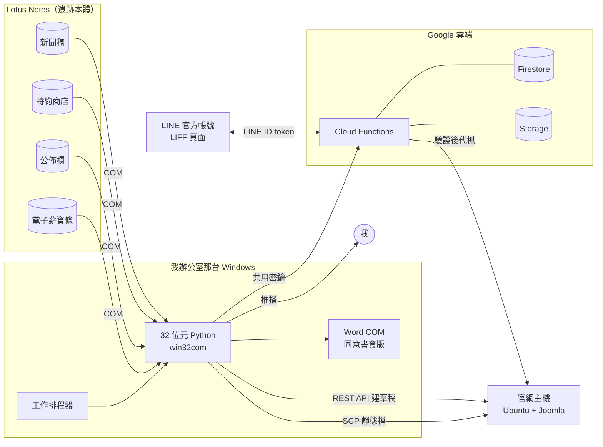
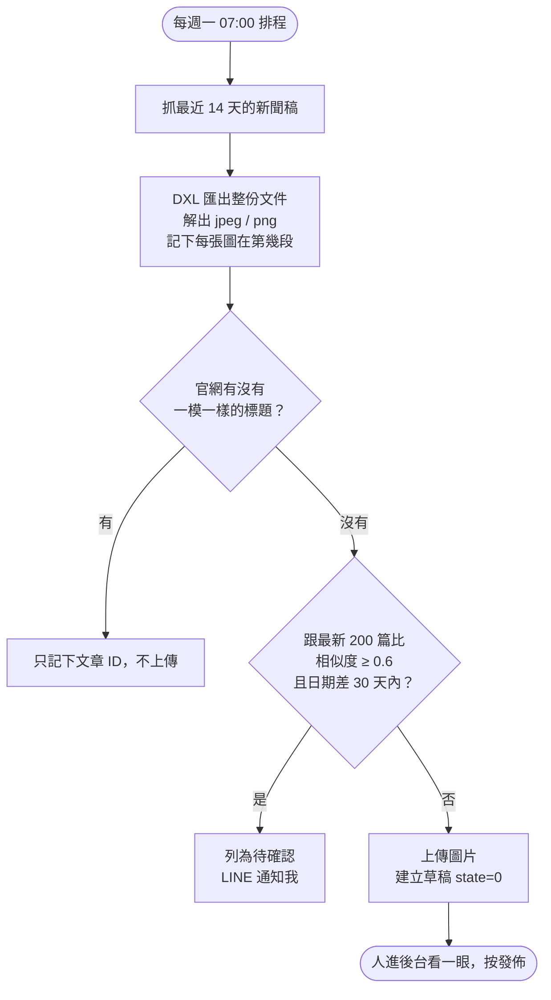
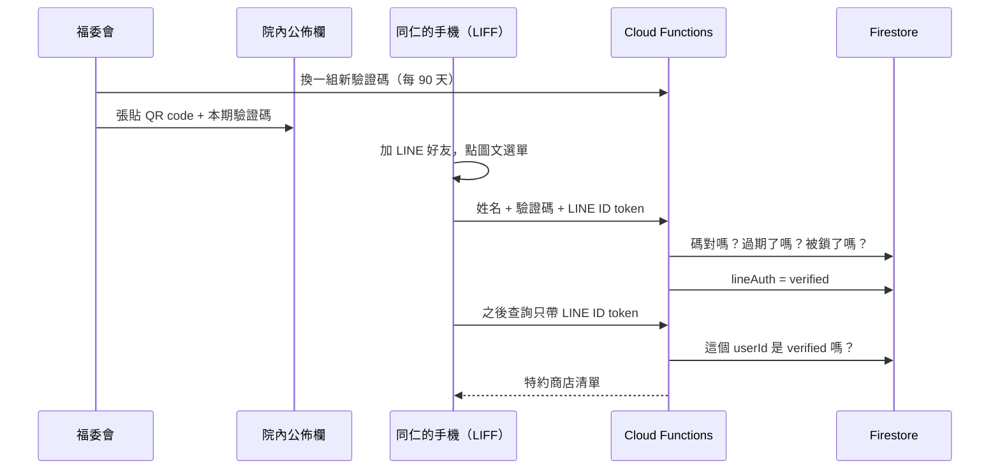
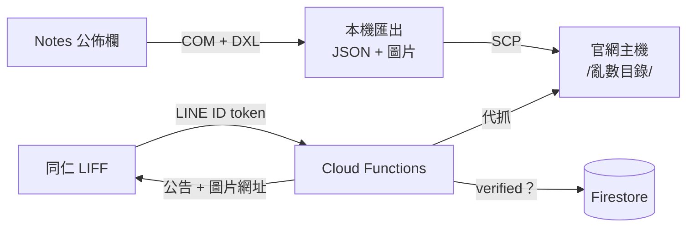
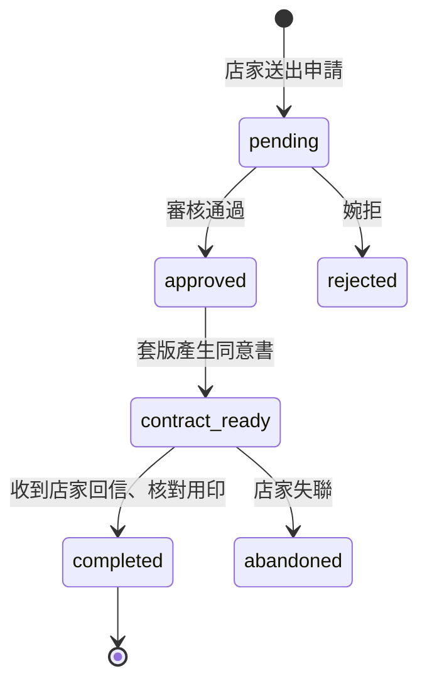
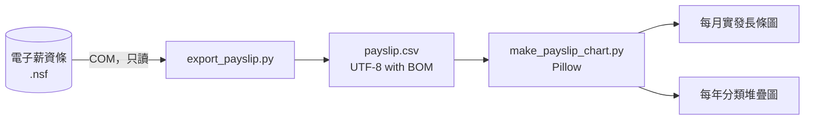

## 遺跡現場


醫院裡有一套 Lotus Notes。

Lotus 在 1989 年做出來，六年後被 IBM 買走，再後來又被轉手給 HCL。它比我們院裡很多同事都資深，我們用了十幾年，大概還會再用十幾年。

新聞稿、公佈欄、特約商店、薪資條，全部住在裡面，一個功能一個資料庫，副檔名叫 `.nsf`。

資料都在，就是出不來。想把東西搬到別的地方，標準作業程序是：打開用戶端、點開文件、全選、複製、貼上。重複到退休。

好消息是 Notes 留了一個後門給程式用，叫 COM。Windows 上的 Python 用 `win32com` 叫起 `Lotus.NotesSession`，拿自己的 Notes ID 登入，就能像用戶端一樣開資料庫、讀 View、讀欄位。不用碰伺服器，也不用寫公文去跟誰要 API。

```python
import win32com.client

session = win32com.client.Dispatch("Lotus.NotesSession")
session.Initialize(password)
db = session.GetDatabase(server, "OAuse\\ContributingStore.nsf")
view = db.GetView("依商店")
doc = view.GetFirstDocument()
while doc:
    name = doc.GetItemValue("fd_ObjectName")[0]
    doc = view.GetNextDocument(doc)
```

壞消息是那個 COM 元件是 32 位元的。

呼叫它的行程也必須是 32 位元，所以整個專案跑在一個 32 位元的 Python 3.14 上。2026 年，32 位元，像一個甩不掉的前同事。

## 整座遺跡長這樣

從六月挖到現在，大概長成這個樣子：



分工有一條規矩，每個功能都照著走：重活在本機做，雲端只管狀態跟權限。

本機那台電腦手上沒有任何 Firebase 憑證，要寫資料就拿一組共用密鑰去敲 Cloud Functions 的管理端點，敲完就走。它是整條路上權限最小的一環，這是刻意的。那台機器放在院內、沒有公開 IP，也不一定隨時開著，本來就不該讓它扛重要的東西。

每個功能動手前，我都先寫一份規格書，寫要做什麼、不做什麼、驗收怎麼算。寫完再丟給 AI 一起做。下面一個一個講。

## 新聞稿自己走上官網

### 為什麼要做

官網上的新聞，源頭是 Notes 裡的新聞稿資料庫。一篇新聞稿寫好了，要出現在官網上，中間得有人把文字複製出來、圖片一張一張另存、再到 Joomla 後台貼上、上傳、排版。一篇還好，一週好幾篇就是固定的苦工，圖片常常漏帶，排版常常跑掉。

我想把搬運這一段交給程式，人只負責最後看一眼、按發佈。

### 怎麼做



- 擷取用 DXL。把整份 Notes 文件匯出成 XML，照順序走一遍，文字段落跟圖片的相對位置記在 `layout.json`，上傳時照著排回去。圖說接在圖片下面，第一張圖設成摘要圖片，跟同事手工上稿的樣子一樣。
- 上傳走 Joomla 4 的 REST API，先傳圖片到媒體庫，再建文章。
- 文章一律建成草稿，`state=0` 寫死在程式裡。按發佈這件事永遠留給人，程式寫錯頂多多一篇草稿，不會半夜在官網首頁冒出一篇亂碼。
- 上傳前先查重。同事也還在手工上稿，標題一模一樣的直接跳過；長得很像的，多半是上稿時改過標題，列成待確認，LINE 我來決定。

整條流程裡需要判斷的只有「這兩篇是不是同一篇」，最後又本來就有人審稿，所以用排程加一則 LINE 通知就夠了，沒有動用 agent。

### 做完之後

每週一早上，上週的新聞稿已經在 Joomla 後台排好隊，圖片、圖說、摘要圖都放好了。負責上稿的人不用再複製貼上，只要打開草稿看一眼，按發佈。

## 特約商店讓同仁用 LINE 查


### 為什麼要做

職工福利小組幫同仁談了一百多家特約商店，資料在 Notes 的特約商店資料庫。同仁想知道哪家店有優惠，只能回辦公室打開 Notes 查。可是會想查優惠的時候，人通常不在辦公室，手上只有手機。


另一個條件是只能給同仁看。店家願意給折扣，是因為這是醫院員工專屬的優惠，有些合約還白紙黑字寫著「本優惠僅提供予甲方所屬員工，不得轉借他人使用」。查詢頁如果公開，等於醫院自己把員工專屬的清單貼在網路上。

所以要做的是一個手機查得到、在醫院外面也查得到、但只有本院同仁看得到的查詢頁。

### 怎麼做

入口放在 LINE 官方帳號，大家手機裡本來就有 LINE，不用再記一組帳號密碼。




- 驗證碼只貼在院內公佈欄，看得到院內公告的人才拿得到。第一次輸入姓名和驗證碼，之後就靠 LINE 帳號認人，不用再驗證。
- 前端是 LIFF，嵌在 LINE 裡的網頁。後端是 Cloud Functions（Python）加 Firestore。
- 權限只在後端判斷。Firestore 的安全規則是全部拒絕，只有後端寫得進去；能把一個人標成「已驗證」的路徑只有一條，就是輸入正確的驗證碼。
- 連續打錯會鎖一段時間。驗證碼 90 天換一次，到期前 14 天 LINE 提醒我。
- 每季拿在職名單比對一次，離職的人撤銷查詢資格。預設只產生報告，確認沒問題才真的撤銷。
- 特約商店資料由本機程式從 Notes 讀出來，同步到 Firestore。

也有刻意不做的。不查證你是不是真的叫這個名字，不蒐集身分證字號。真正兌換優惠時要在店家櫃檯出示識別證，網頁只要擋住「路人用 Google 搜到網址」就夠了。

### 做完之後

同仁在 LINE 裡點一下就能查，人在店家門口也查得到。這個 LINE 官方帳號目前大約有 400 位同仁加好友。

福利小組這邊，合約裡「員工專屬」的承諾守住了，換驗證碼也只是一行指令。

## 福利公告搭便車

### 為什麼要做

福利小組平常在院內公佈欄發公告，中秋禮盒預購、好康轉知那些。公佈欄是另一個 Notes 資料庫，全院各單位的公告擠在一起，同仁要自己翻，而且一樣只能在辦公室的 Notes 裡看。

既然同仁已經在 LINE 裡查特約商店了，福利小組的公告放在同一個地方，剛好順路。

### 怎麼做



- 從公佈欄只挑福利小組發的、還沒過期的公告，圖片用跟新聞稿一樣的 DXL 手法挖出來。
- 身分驗證直接沿用特約商店那一套，驗證過的同仁不用再輸入一次。
- 資料不進 Firebase。JSON 跟圖片放在官網主機上一個用亂數命名的目錄，沒有任何頁面連過去，目錄列表回 403。同仁查詢時，Cloud Functions 先確認身分，再代替使用者去抓，瀏覽器不知道真正的網址。

保護比特約商店鬆，是刻意的。公告本來就是貼給全院看的轉知訊息，用不著跟有合約限制的資料穿同一件防彈衣。

### 做完之後

同仁在 LINE 圖文選單多了一個「福利公告」，只看得到福利小組的公告，不用在全院公告裡撈。上線時有 18 則公告、30 張圖。

## 店家線上申請

### 為什麼要做

原本店家想加入特約，要自己打電話或寄信給福利小組。福利小組接到之後，把店名、統編、優惠內容一項一項記下來，填進合約、寄給店家、等店家蓋好章寄回來。整段都在系統外面，哪一家卡在哪一步，只能靠人記。

我想把能數位化的部分搬到線上：店家自己填表，資料直接進系統，文件自動產生，進度查得到。

### 怎麼做



- 申請表是公開網頁，送到 Cloud Functions，存進 Firestore。防濫用用蜜罐欄位加每個 IP 每天限送 5 次。
- 送出後給店家一組申請編號跟查詢碼，隨時可以上網查進度。編號用日期加序號，像 `20260909-03`，電話裡念得出來。
- 審核是我電腦上的一支命令列程式。審核時順便拿統一編號查經濟部的開放資料，看登記名稱對不對得上，只當參考，不擋件。
- 核准後，本機程式把申請資料套進同意書範本，產生 PDF。範本是 docx，直接改裡面的 XML，不用開 Word。
- 同意書用 Email 寄給店家，店家蓋好章直接回信。特約商店多半是小店，收信、蓋章、回信最直覺。
- 新申請進來時，LINE 通知管理者，訊息只有店名、類別、編號，不放負責人和電話。

旁邊還有兩支小工具，都是為了讓福利小組少做一點事。

一支是新增特約商店時，用 Pillow 自動產生一張全院公告圖，店名、地址、電話、期限排好，長店名會自己縮字。

另一支是到期檢查，為的是續約。合約裡寫著期滿會自動展延，但 Notes 裡的到期日不會跟著改，日期一過，查詢頁就把這家店當成過期藏起來，店家明明還在配合，同仁卻查不到。九月的資料裡，113 家有 52 家的到期日落在 2026 年 12 月，不處理的話，年底會有快一半的店一口氣從查詢頁消失。所以這支程式每個工作天檢查一次，到期前 60 天先 LINE 我，讓福利小組有時間跟店家確認，把 Notes 裡的日期改掉。

### 做完之後

店家不用再打電話問「現在到哪了」，上網輸入編號就知道。

福利小組不用再抄資料、填合約，核准之後同意書自己長出來；每一件申請卡在哪一步，系統裡都看得到。快到期的店家會提前被提醒，新店家的公告圖也不用另外找人做。

## 我自己的薪資條

### 為什麼要做

最後一個是私心。

薪資條也在 Notes 裡，一個月一張，只能一張一張點開看。想知道這幾年薪水怎麼走、哪幾個月有加班費，就得逐月翻，翻完還記不住。

### 怎麼做



- 讀 Notes 跟畫圖拆成兩支。讀 Notes 要 32 位元、要先關掉用戶端，很嬌貴；畫圖只讀 CSV，想重畫幾次都行。
- 資料庫本身有讀者欄位控管，我的 ID 只看得到我自己的，程式不用另外過濾。別人的也看不到，請不要問。
- 明細分在兩個欄位，固定項目一個，加班費、績效獎金這類其他給付另一個，兩個加起來才是合計。每一筆匯出都會核對：明細加總要等於應發、應扣，應發加應扣要等於實發，對不上就印警告。
- CSV 用 UTF-8 with BOM，Excel 直接打開不會亂碼。畫圖用 Pillow，因為 32 位元的 Python 3.14 裝不了 matplotlib。

隱私是這份規格書寫最多的部分。輸出資料夾列進 `.gitignore`，程式碼和文件只出現欄位名稱，測試用假數字，終端機只印筆數不印金額，身分證字號、銀行帳號這些欄位程式根本不讀。

### 做完之後

受惠的只有我一個。幾年的薪資攤成兩張圖，哪一年加班多、獎金落在哪幾個月，一眼就看得到。圖長什麼樣子，這篇不會放。

## 出土清單

| 東西 | 從哪裡挖出來 | 送去哪裡 | 誰用得到 |
|---|---|---|---|
| 新聞稿 | 新聞稿資料庫 | Joomla 草稿 | 負責官網上稿的人 |
| 特約商店 | 特約商店資料庫 | Firestore → LINE | 全院同仁、福利小組 |
| 福利公告 | 院內公佈欄 | 官網主機亂數目錄 → LINE | 全院同仁 |
| 店家申請 | 店家自己填 | Firestore → 同意書 PDF → Email | 特約店家、福利小組 |
| 薪資條 | 電子薪資條 | 本機 CSV 跟兩張圖 | 我 |

如果你的單位也有一套丟不掉的 Notes，COM 跟 DXL 這兩招應該挖得動。記得先準備一個 32 位元的 Python。
