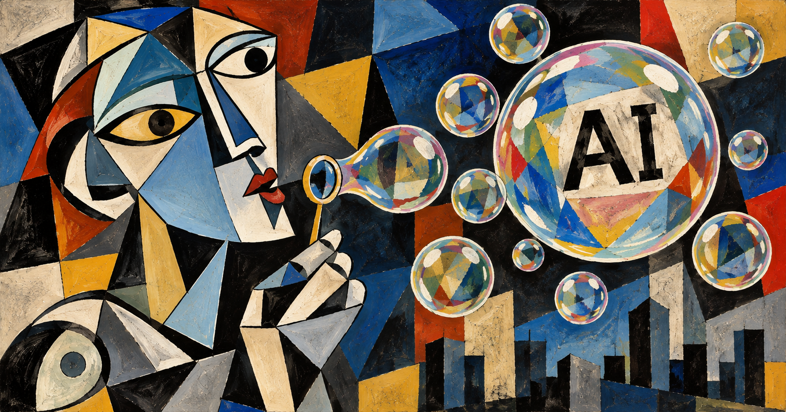

這個禮拜美股的新聞一則比一則難看。

先是 Google 跌了 12.64%，收 283.82 美元，上市二十幾年來最差的一天，市值一天少掉快五千億美元。

週五換 Intel，跌 28.58%，四十年來沒跌成這樣過。

SanDisk 跌 13.47%。Reddit 跌 29%。那斯達克整體跌 2.86%，算是被這幾家拖下去的。

奇怪的是，這幾家的財報沒有一家是爛的。

Intel 第三季 EPS 0.52，大家原本只估 0.40。Google 營收跟預期只差了零點幾個百分點，雲端收入翻倍，搜尋量成長是五年來最快。SanDisk 營收比上一季多 23%，調整後 EPS 49.51 美元，是去年的四十幾倍，簽好的訂單還有 911 億美元。

成績單都好看，股價一起往下掉。網路上的說法很一致：AI 泡沫要破了。

我沒有在研究股票，這篇也不是在講投資。泡沫哪一天破，我不知道。

我想的是另一個問題。這幾年 AI 很強，這沒什麼好爭的。可是它做出來的，到底是本來不存在的新價值，還是只是把原本就在的價值，從一群人手上換到另一群人手上。

我目前比較傾向後者。

## 先從錢包開始

最有感的是硬體。

今年記憶體跟快閃記憶體一路漲。iPhone 光記憶體就吃掉四成成本，標準版乾脆停了。新的 iPad mini 只給 128G，裝兩款大型遊戲就滿了。Android 廠商也陸續不做便宜的入門機。

Intel 自己估，今年 PC 市場會縮 12%，明年再縮 10%。

這些記憶體去哪了，答案是雲端。AI 推理要大量硬體，資料中心先搶，剩下的才輪到一般人的手機和電腦。

Sam Altman 之前說，在個人電腦上跑本地模型是在浪費記憶體。他是做大模型的公司，站在他的位置，記憶體放在資料中心當然比放在你桌上有用。

只是對我來說，結果就是下一台電腦會更貴。

## 我寫了 12 個專案

我自己上半年在研究所，三堂課加起來 12 個專案，幾乎每一個都是靠 AI 才趕得出來。

如果只看產量，那半年大概是我這輩子寫最多程式的時候。

但那 12 個 repo 現在就是排在 GitHub 上。交了作業，拿了成績，沒有一個變成收入。

身邊也有人在下班後狂寫，盯著各家額度幾點重置，一個 side project 接一個上線。我沒聽說誰真的靠這個賺到錢。

有人問過一群寫 vibe coding 的人，這樣算省時間還是殺時間。多數人說是殺時間。後來有人說 AI 不是做給企業，也不是做給消費者，是做給自己開心。我覺得有點道理。

拉大一點看也差不多。軟體公司的程式碼量暴增，一年寫完以前十年的量，可是產品收入沒有跟著多出好幾倍。

雲南今年的藍莓多產了 39%，價格掉了一半。大量鮮果同時進市場，買的人沒有變多，每一盒只好賣便宜一點。

程式也是這樣。你做得出來的東西，你的對手一天也做得出來。原本只有三家在做的生意，現在三十家都能做，客人得到更便宜的服務，每一家分到的都變少。

模型的 Token 在降價，用模型做的產品在降價，靠腦袋吃飯的工作也在降價。想維持原本的收入，就要多跑好幾倍的量才打得平。

AI 讓很多以前不值得做的小東西，現在隨手就做出來了。這是真的。只是隨手做出來的東西，通常也很難賣。

## 沒人點進來了

Reddit 那 29% 的跌幅，執行長 Steve Huffman 在法說會上的解釋很短：Google 的 AI Mode 直接把答案給你，沒人點連結了。

他說：「AI 不會帶來流量，沒有帶給我們，也沒有帶給其他人。」

10 月份，Reddit 每週從搜尋引擎進來的造訪少了一百多萬次。美國每天進站的人數一年少了 2%，是上市以來第一次往下。

這則新聞我看得比較久，因為我的工作就是顧醫院的網站。

過去二十幾年大家默認的規則是：網站把內容寫好，Google 把人帶過來。現在 AI 把內容讀完、整理成一段話，使用者看完就走，那個「帶過來」的步驟不見了。

Reddit 已經是網路上最像真人在聊天的地方，它都掉成這樣，一般網站更不用說。

再往下想一層，經濟是靠交易轉起來的。我付錢給你，你拿去付給別人，錢一直在不同人手上轉。用 AI 直接拿到結果，中間幾乎沒有人經手，錢就沒有繼續往下轉。

連幫人轉賣模型額度的 API 中轉站，現在也很難賺。今年從 Claude Opus 4.5 到 DeepSeek Flash 4.1，做同一件事的 Token 價格掉了 50 到 100 倍，明年大概還會再掉 10 倍。聽做這行的人說，營收數字看起來還行，扣掉成本沒剩多少，Luna 那種便宜模型已經沒什麼人在賣了。Token 比他們自己的伺服器還便宜。

## 賺到的錢去了哪

這週另一則新聞：微軟對 6 萬名員工開放自願離職，超過全公司四分之一。

微軟沒有虧錢，反而賺得比以前多。只是 AI 的投資一直加，加到預算不夠，就從人身上省。

唯一讓我覺得 AI 好像真的做出新東西的，是字節的紅果短劇。

番茄小說出劇本，Seedance 生影片，巨量引擎接廣告，紅果自己有每天的活躍用戶跟觀看時長。從寫故事、做影片、推給誰看到誰在看，一條龍都是自己家的。看短劇的人從年輕人到長輩都有，這比抖音還誇張。

照理說這應該是最會賺錢的模式。

可是字節去年賺了大概 500 億美元，今年打算花最多 700 億美元蓋 AI 基礎設施。賺的錢不夠花，還要再多掏。

硬體廠的錢往 AI 去，軟體公司的錢往 AI 去，連自己做出閉環、真的有賺到錢的字節，錢最後也往 AI 去。

我看了一圈，現在大家拚命在做的是把產能拉高。拉高之後錢要怎麼回到買東西的人手上，我還沒看到誰有答案。

## 我不知道

我不覺得這個週五就是那個崩盤的日子。

過去幾次科技週期，通常是先吹出一個大泡沫，再狠狠跌一次，跌完之後，留下來的人才開始把技術用在真正需要的地方。2000 年的網路是這樣。

ChatGPT 是 2022 年 11 月出來的，到下個月剛好滿四年。

Anthropic 據說下個月上市，有人說那天就是 AI 泡沫的頂點。

我不知道會不會是。我只知道下次換電腦要多存一點錢。
