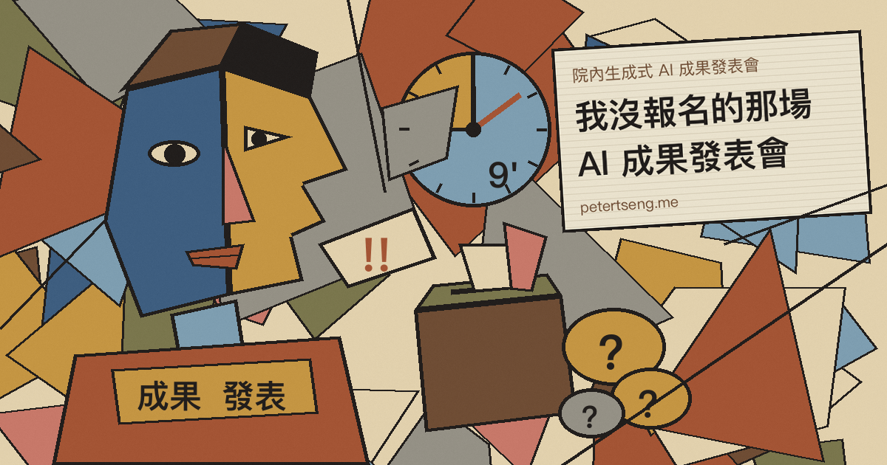

昨天中午，院裡辦了一場生成式 AI 成果發表會。

海報上寫，今天共有 17 組團隊登場，歡迎同仁到場聆聽、為發表團隊加油，並參與現場投票，選出心中最便利、最實用的 AI 應用佳作。一張海報兩個驚嘆號。

時間是中午十二點半到下午三點，兩個半小時。17 組平均下來，就算不扣開場跟投票，一組也分不到九分鐘。

我沒報名，當天也沒去。

## 獎金少少的

為了那一點錢，把自己的 repo 攤開來給大家看，我不太願意。

裡面是我這幾年一點一點磨出來的東西，很多是讓我能忙裡偷閒的自動化agent。如何高效摸魚這種事，不太適合拿上台發表，更何況開發了許多暗黑工具。

而且報名不是只有上台那九分鐘。要寫摘要、做簡報、配合彩排，還要把原本只有自己看得懂的東西，整理成別人看得懂的樣子。這些時間加起來，換那一點獎金，怎麼算都不划算。

我算過了，所以沒報。

## 名單出來了

後來全院公告，公告的只有得獎名單。第一名到第三名，再加兩組佳作，每一組一個單位、一個題目。

平台、小幫手、決策支援系統，題目都取得很長，很有氣勢。有一組的題目長到要分三行印，做海報的人應該很辛苦。

題目很長，其他的就沒了。為什麼是這一組拿第一，評審看重哪一點，公告上一個字都沒有。

17 組裡選出 5 組，沒去現場的人，只知道誰贏了，不知道為什麼贏。

## 現場投票選實用

另一個讓我想不通的，是現場投票。

海報說，要大家選出心中最便利、最實用的 AI 應用。

我沒去，不知道台上怎麼講。可是用算的也知道，每一組不到九分鐘，坐在台下的人，大概沒幾個真的用過台上的系統。聽完就要投票，選哪一個最實用。

這樣選出來的，是簡報做得最好的那一組，不一定是最實用的那一組。

實不實用，要讓使用的人用個三個月才知道。半夜十二點、系統卡住、病人在等的時候，它有沒有幫上忙。這種事，在會議室裡投不出來。

## 什麼叫 AI 應用

用 AI 幫忙寫出一套系統，跟這套系統本身會用到 AI，是兩件事。

前面那件，在我們這行有個名字，叫寫程式。以前抄 Stack Overflow，現在抄 AI，抄得比較快而已。如果這樣也算 AI 應用，那我這些年寫的每一支程式，大概都可以回頭補報名。

後面那件才比較難。模型放在流程的哪一段，答錯了誰負責，資料能不能送出去，送出去之後存在誰的伺服器上。在醫院，這幾個問題每一個都比系統本身難。

這些在公告上都看不到。

哪一組用了 RAG，把院內的規章、衛教資料餵給模型去查。哪一組做成 agent，讓模型自己去撈資料、填表單、跑流程。哪一組其實是把一段提示詞包成一個網頁。這三種做法，難度差很多，成本也差很多。

還有用的是哪一個模型。GPT、Claude、Gemini，還是院內自己架的開源模型。資料要不要送出院外，就看這一題。

有沒有用 MCP，有沒有用到機器學習，有沒有做蒸餾人格。

最後是創意在哪裡。同樣是做排班，同樣是做衛教，這一組跟別人不一樣的地方是什麼。

這些問題，公告上一題都沒回答。只有題目。光看題目，分不出來。

一場叫做生成式 AI 的成果發表會，公告上看不到任何一個 AI 的技術名詞。

看到這裡，我其實有點懷疑。主辦單位手上掌握的，會不會只有評分這件事。誰上台、誰得獎，是他們決定的。可是每一組用了什麼、做得好在哪裡，他們自己可能也說不太出來，所以公告上只能放名單。

## 沒人講的帳單

還有一件事，公告上也沒有。

這些系統上線之後，每個月要燒多少 token，錢從哪裡出，用的人一多帳單會長成什麼樣子。

用的人少的時候，帳單看起來很可愛。用的人一多，每一次查詢、每一次生成都在計費。模型換代，價格會變。廠商改方案，額度會變。系統是做給全院用的，總不能說這個月額度用完了，下個月請早。

做出來只要幾個禮拜，養下去才是真的開始。

這件事我比較有感，因為我自己每天都在燒。

## 一次呼叫多少錢

成果發表，總會有一頁講效益。每天省下幾小時、減少多少人工、滿意度提升多少。

這些都是分子。分母很少有人放上來。

一個 AI 系統的效益，其實算得出來，只是有點麻煩。

先算成本。一次呼叫送進去多少 token、吐出來多少 token，乘上模型的單價，就是一次的錢。再乘上一天呼叫幾次、一個月幾天。

舉個假設的數字。一次呼叫算一塊台幣好了，全院一天用兩千次，一個月就是六萬。這還只是模型的錢，伺服器、串接、維護的人力另外算。

再算效益。省下的工時乘上時薪，才是省下來的錢。但要扣掉人去檢查 AI 輸出的時間。在醫院，AI 寫出來的東西不可能不看就用，檢查的時間常常比想像中長。答錯一次要補救，那個成本更難算。

最後還有變數。模型一年換好幾代，舊模型下架，提示詞要重調，輸出格式會跑掉。今年算出來划算，明年不一定。

這幾件事算完，有的系統很划算，有的其實是在用 token 換一張好看的簡報。

哪一組是哪一種，我不知道。也許有人在台上算過，但公告上沒有，沒去現場的人就看不到。

## 其實不難

抱怨完，也講幾個我覺得可以改的地方。給主辦單位參考。

評分標準先公告。創新幾分、實用幾分、成本幾分，大家照著準備，評審照著打。

報名表加一欄，一個月預估要花多少錢，誰付。寫不出來的，代表還沒想清楚。

公告得獎名單的時候，每一組多寫兩三行。為什麼得獎，用了什麼技術，花多少、省多少。全院大部分的人都沒去現場，看了公告至少也能學到一點東西。

再進一步，乾脆直播。

中午十二點半到三點，大部分的人在上班，在病房、在門診、在櫃檯，不可能走開兩個半小時。我也是其中一個。開個直播，再把錄影放在院內網站，想看的人下班再看，只看自己有興趣的那一組也可以。

投票也可以放到線上。看完錄影的人才能投，至少知道自己在投什麼。

直播還有一個好處。每一組講了什麼、評審問了什麼、最後誰得獎，全部攤在大家面前。得獎的人拿得比較安心，沒得獎的人也比較服氣。

最後，獎不要當天發完。上線半年之後，回頭看每一組的使用量、實際花了多少、省了多少，再發第二次獎。真的有人在用的系統，到時候自然看得出來。

這幾件事都不難，也不花錢。

## 不值得

有些比賽，根本不值得參加。

不是因為獎金少。是因為參加完，沒有人告訴你為什麼贏、為什麼輸。你做的東西好在哪裡，哪裡還不夠，評審看重什麼，一個字都不會有。輸了學不到東西，贏了也說不清楚贏在哪裡。

這場對我來說，就是這一種。
