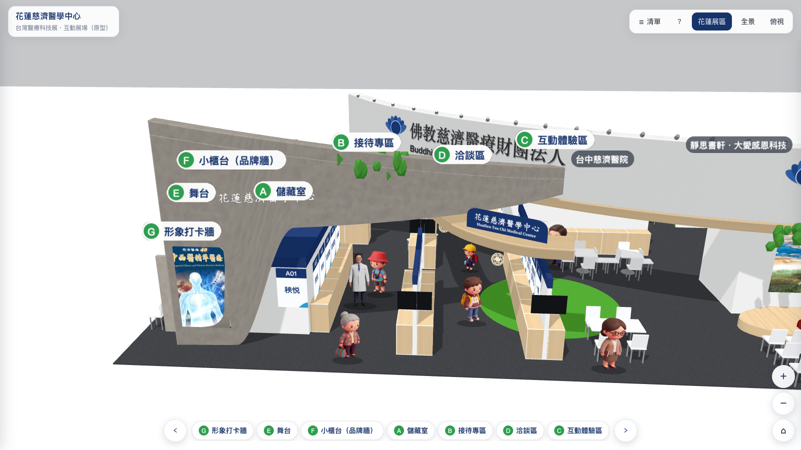
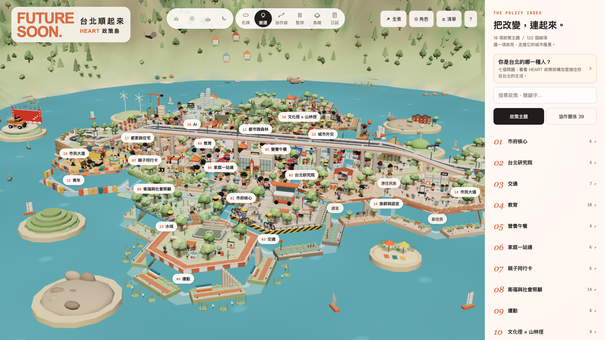

打開這個網站，院長會從展區裡面走出來，走到你面前揮手，頭上冒一個泡泡：歡迎參觀花蓮慈院展區。

院長是一張紙板。

年底的台灣醫療科技展，12 月 3 日到 6 日在南港展覽館一館四樓，花蓮慈院一樣會參展。

依照慣例，我做了一個[專網](https://hlm.tzuchi.com.tw/home/index.php/expo)。展覽日期、交通、講座、體驗活動、歷年成果，一頁放完。這部分每年都差不多，換年份、換內容而已。

專網最下面有一排連結，2024、2025、2026 台灣醫療科技展 VR。往年點進去，看到的是展覽結束之後拍的現場照片。說是 VR，其實是相簿。

今年那一格換成了這個：[互動展場](https://hlm.tzuchi.com.tw/vr/expo2026/)。

展場還沒搭，攤位還在圖面上，但已經可以進去逛了。

## 沒人叫我做

這個沒有人交代，是我自己想做的。

起因是看到台北市長參選人沈伯洋的[政策島](https://puma.taipei/heart-island)。

政策島把 18 項政見做成一座島。19 個六邊形拼成台北市的輪廓，一格一項政見，上面蓋滿小房子、小樹、小人。點一格，或從右邊的清單點，就能看那項政見的細項。政見之間有關係的，還會拉一條線連起來。它也是用 three.js 做的。



看完就在想，醫療展的展區，應該也可以做成一個讓人進去逛的地方。

兩個網站要做的事不太一樣。政策島是把一份政見，蓋成一座還不存在的城市。我要做的比較單純，是把一個再過幾週就會搭起來的展區，照平面圖先蓋一次。不過回頭看，我畫面上方的「全景」和「☰ 清單」兩個按鈕，跟政策島的幾乎一樣。

醫院每年辦醫療展，很多人辛苦準備，展完四天就拆掉，最後留下來的是一本相簿。照片只拍得到某個角落，拍不到整個展區長什麼樣子。

3D 場景可以從入口走到最裡面。哪個單位在哪一面牆，海報掛在哪裡，舞台、洽談區、體驗區怎麼排，都在裡面。我想替每年的醫療展留一份這樣的紀錄，許多年後回頭看，還找得到當年的樣子。

前後大概三天做完。程式本身沒有卡太久，卡最久的是院長。

## 從平面圖開始

手上有的資料，主要是展區的平面圖，再加上幾張展場的設計示意圖。

平面圖的單位是公分。整個慈濟展位大約 45 公尺寬、15 公尺深，台中、大林、台北慈院也在裡面，花蓮展區佔最左邊的十幾公尺。我就直接拿圖上的數字當座標，原點放在展場左下角，寫一個小函式換成 three.js 的公尺：

```js
const V = (x, y, h=0) => new THREE.Vector3(x/100, h, (1500-y)/100);
```

平面圖的 y 往上長，three.js 的 z 往鏡頭這邊長，所以 y 要倒過來。這一行寫錯，整個展場就會前後顛倒。

接著把海報位置整理成一個陣列。每一張海報六個欄位：編號、單位、x、y、朝向、在哪一面牆。

```js
const POSTERS = [
  ['A01','秧悦',470,196,'S','st'],
  ['A02','秧悦',518,276,'E','st'],
  ['A24','AI中心',835,450,'W','w5'],
  // ...
];
```

43 類海報，全部照這個格式排下去。平面圖上的編號跟陣列裡的編號一樣，現場佈展的同事拿著圖對得起來，有改動的時候我也只要改這一行。

## 沒有模型檔

這個場景裡沒有任何 3D 模型檔。沒有 glTF，沒有 Blender，也沒有 npm。

展示牆是長方體，海報是平面，白色弧形主牆是沿著一條圓弧拉出來的帶狀面，拱門和木質天花也是同一個函式。桌椅、儲藏室、舞台，全部用幾個小函式在程式裡一塊一塊堆出來。

材質也一樣。木紋、清水模、地毯、草皮，都是先在一張 canvas 上用程式畫出來，再當成貼圖貼上去。

```js
let seed = 7;
const rnd = () => (seed = (seed*16807) % 2147483647) / 2147483647;
```

亂數用的是固定種子，不是 `Math.random()`。這樣每次打開，木紋長得都一樣，不會這次重新整理多一條紋路、下次少一條。

整個網站的檔案就是一個 `index.html`、一份 three.js、一份 OrbitControls，加上一些圖片。three.js 用的是 r128 那種直接用 `<script>` 引入的舊版寫法，不用打包，不用建置，丟上醫院的主機就能跑。專網本身是 Joomla，3D 展區就放在旁邊一個資料夾，兩邊互不干擾。這一點對我來說比用最新版重要。

壓縮過的 three.js 大約 600 KB，是整個網站最大的一個 JavaScript 檔。

## 紙板人

空蕩蕩的展場看起來很假，所以場景裡放了一些參觀民眾。阿嬤、學生、上班族、小朋友、登山客，一共十個。

他們不是 3D 模型，是 AI 生成的黏土風角色圖，去背之後貼在一張平面上，像紙板人。平面永遠轉向鏡頭，所以不管從哪個角度看，看到的都是正面。

紙板要看起來像在走路，只做了三件事：沿路線移動時上下顛一點、左右晃一點，往畫面右邊走的時候把圖左右翻過來。走到轉角，有一半的機率會停下來看一下，再繼續走。

這樣就夠了。展場的鏡頭通常拉得遠，沒有人會去細看阿嬤的腳有沒有在動。

開頭那位院長，也是這樣做的。他從展區裡面沿著一條路線走出來，邊走邊慢慢變大，走到地毯前緣再往前踏一步、放大一點，然後開始揮手。

這三天裡，我想最久的就是院長要不要做成 3D。院長的卡通人偶要做成 3D 模型，得另外花一筆錢，這次沒有這個預算，要做就只能花我自己的錢。我不想。所以現在只能先讓院長跟阿嬤、小朋友一樣，當一張會揮手的紙板。

揮手是三張圖輪播。三個畫格沒有拼成一張圖，而是各自一個檔案。拼成一張、用貼圖偏移切換，檔案比較少，可是鏡頭拉遠、貼圖縮小之後，隔壁畫格的手會滲進來。分開放就不會。

如果使用者的系統有開「減少動態效果」，院長不會走出來，民眾也不會走，畫面直接停在花蓮展區。

```js
const willGreet = !matchMedia('(prefers-reduced-motion: reduce)').matches;
```

## 兩種逛法

預設是一般 3D 檢視器的操作，拖曳轉視角，滾輪縮放，可以切全景、俯視、花蓮展區三種視角。

另外一種是走進去。按 WASD 或方向鍵，手機上按住左下角的圓形搖桿推，鏡頭會降到 1.65 公尺，大約是一個人的眼睛高度。這個高度看出去，展示牆比視線高，比較像真的站在展場裡。

走進去之後就會撞牆。我沒有用物理引擎，碰撞的做法很陽春：從腳下的位置往八個方向各打一條半公尺的射線，打到牆或櫃檯就算擋住。

```js
function clearAt(x, z) {
  const o = new THREE.Vector3(x, 1.1, z);
  for (let a = 0; a < 8; a++) {
    const d = new THREE.Vector3(Math.cos(a*Math.PI/4), 0, Math.sin(a*Math.PI/4));
    if (new THREE.Raycaster(o, d, 0, .5).intersectObjects(solids, false).length) return false;
  }
  return true;
}
```

擋住的時候，再把移動拆成 x、z 兩個方向分開檢查。這樣斜著走去撞牆，會沿著牆滑過去，不會整個人卡住不動。

點一張海報，鏡頭會飛到海報前面。如果飛過去的路上有牆或拱門擋著，就停在障礙物前面，不會穿牆，也不會停在牆壁裡面看到一片白。

## 手機點不準

電腦用滑鼠點海報很準。手機就不行了，海報在畫面上可能只有指甲大，手指一按，常常點到海報旁邊的地板。

所以手機上多了一層補救。射線沒點中任何東西的時候，就去找離手指 34 像素以內最近的海報，條件是海報要朝向鏡頭，中間也不能被牆擋住。背對你的海報、牆後面的海報，就算在螢幕上剛好很近，也不算。

在海報上點兩下才中，跟點一下就中，使用感差很多。

操作說明也分兩套。同一個說明框，滑鼠裝置看到的是「按住左鍵拖曳」，觸控裝置看到的是「單指拖曳」，用 CSS 的 `pointer: coarse` 判斷，不用寫 JavaScript。

## 內容跟程式分開

這個網站要上線，最大的問題不是 3D，是內容。

43 類海報，來自二十幾個單位，每個單位交稿的時間都不一樣。如果每收到一張海報，就要我去改一次程式，展覽前兩週我大概只剩改程式這件事可以做。

所以內容拆成兩個地方。

海報圖檔放進 `posters/` 資料夾，檔名就是編號，`A01.jpg`、`A24.png`。網站打開時會讀資料夾裡的檔案清單，有圖的位置就換成真的海報，沒圖的位置先顯示編號和單位名稱的佔位圖。

介紹文字和影片寫在另一個 `content.js`，一張海報一行，同事照著格式填就好，不用碰到場景的程式。

```js
"A01": { title: "", text: "", video: "" },   // 秧悦
```

讀檔案清單這件事，要靠伺服器列出資料夾內容。醫院的主機上，`posters/` 回的是 403，主機把目錄列表關掉了，這是對的設定，不能為了我去開。

最後的解法是一支 `update_poster_list.py`，掃一遍資料夾，把檔名寫進 `content.js` 最後一行的 `POSTER_FILES`。網站先看這個清單，有就用清單，沒有才去讀資料夾。

這樣做還有一個附帶的好處：只載入真的存在的圖。不會對 A01 到 A46 每一個編號都去猜一次 `.jpg`、`.png`，在主控台留下一整排 404。

## 現在的樣子

網站左上角的名字下面還掛著「原型」兩個字。

`POSTER_FILES` 現在是空的，海報還沒有一張進來。`content.js` 裡所有的 `text` 都還是空字串，有兩個位置的單位寫著「單位待確認」。

接下來三個禮拜，就是等稿、放圖、跑一次 `update_poster_list.py`，然後重新整理看看海報有沒有掛對牆。

12 月 3 日開展之後，展區就會真的搭起來。到時候現場照片跟這個模型放在一起，就看得出平面圖蓋出來的展區，跟真的展區差了多少。

展覽結束後，這個模型會跟往年的相簿一起，留在專網最下面那一排連結裡。
